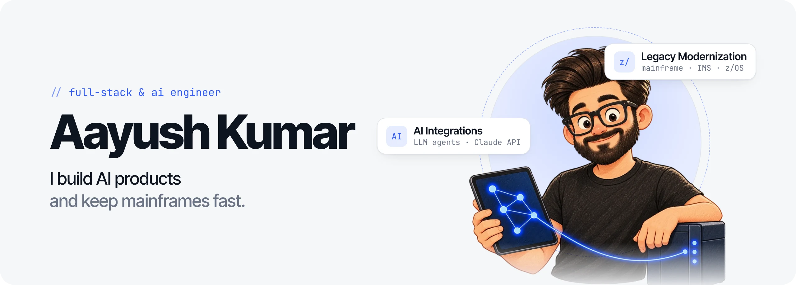
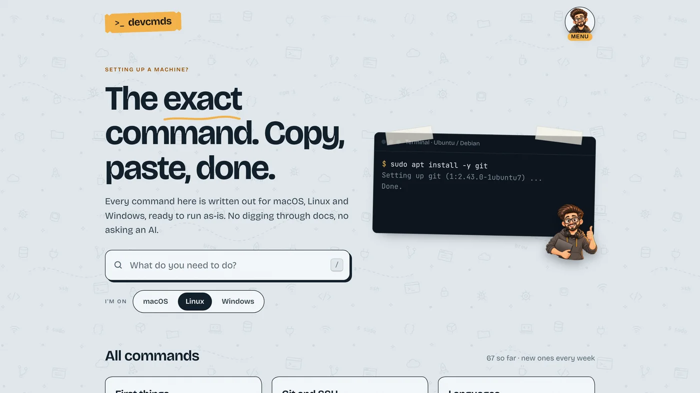

<a href="https://aayushkumar0795.github.io/aayushkumar0795/">
  <picture>
    <source media="(prefers-color-scheme: dark)" srcset="assets/readme-banner-dark.webp">
    
  </picture>
</a>

  9+ years on mission-critical systems · IBM · Bangalore, India

  
  
  

---

## What I do

<table>
  <tr>
    <td width="50%" valign="top">
      <h3>Legacy Modernization</h3>
      At IBM I keep mission-critical IMS environments fast, observable and resilient for enterprise customers, from OpenTelemetry validation to resolving high-severity performance problems for one of Spain's largest banks.
        z/OS · IMS · CICS · DB2 · OpenTelemetry · performance engineering
    </td>
    <td width="50%" valign="top">
      <h3>AI Integrations</h3>
      I ship AI-powered products end to end: React Native frontends, Python and Node.js services on Supabase, and LLM features on the Claude API, plus agents that connect AI to real systems.
        LLM agents · MCP · Claude API · React Native · Node.js · Python
    </td>
  </tr>
</table>

## Live projects

<table>
  <tr>
    <td width="50%" valign="top">
      
      <h3><a href="https://devcmds.dev">devcmds</a> latest</h3>
      The exact command for macOS, Linux and Windows, ready to copy and paste. One task per page, with fill-in fields, a check that it worked and a way to undo it.
        Astro · Cloudflare Workers
    </td>
    <td width="50%" valign="top">
      
      <h3><a href="https://laymanterms.dev">Layman Terms</a></h3>
      A plain-English dictionary of tech words. Every term gets an everyday comparison and its own hand-drawn illustration, so anyone can follow it.
        Astro · Cloudflare Workers · D1 · Turnstile
    </td>
  </tr>
</table>

## More projects

| Project | What it is | Built with |
|---|---|---|
| **QuantumShield** | AI agent for post-quantum cryptography migration planning | AI agent · CBOMkit · NIST PQC · React |
| **Artha** | Wealth intelligence app with an AI assistant and live market data | React Native · Node.js · AI |
| **Mosaic** | Personal finance platform: budgets, accounts and insights in one place | React Native · TypeScript · Supabase |
| **Settl** | Split shared expenses with friends, wrapped as a native iOS app | React · Supabase · Capacitor |

Most of these live in private repos. Happy to walk you through any of them.

## Experience

| When | Role | Company |
|---|---|---|
| Feb 2025 – now | IMS System Programmer, Modernization & Performance | **IBM** |
| Jul 2024 – Jan 2025 | AI/ML Engineer, watsonx Code Assistant for Z | **IBM** |
| Apr 2022 – Jun 2024 | Mainframe Infrastructure Engineer | **Rocket Software** |
| Nov 2017 – Apr 2022 | Mainframe Developer, Insurance Domain | **DXC Technology** |

## Toolkit

**Languages** &nbsp; Python · TypeScript · JavaScript · SQL · Java · COBOL · REXX · Assembler 
**AI** &nbsp; LLM agents · MCP · Claude API · Prompt engineering · Evaluations 
**Full-stack** &nbsp; React Native · React · Expo · Astro · Node.js · Express · Supabase · PostgreSQL 
**Cloud & DevOps** &nbsp; Cloudflare · Vercel · Turborepo · AWS S3 · Ansible · CI/CD 
**Mainframe** &nbsp; IMS DB/DC · z/OS · CICS · DB2 · JCL · SMP/E · OpenTelemetry · IBM RMF

<b>Certifications</b> (8)

 

IMS Fundamentals · IMS Diagnostics · z/OS Mainframe Practitioner · Assembler Programming · IBM Z Digital Integration Hub · Ansible Automation · SMP/E Foundation 2.5 · LOMA 281: Insurance & Annuities

---

   
  <b>Let's build something.</b> 
  Open to full-stack and AI engineering work, agent tooling, and good conversations about bridging legacy systems with modern AI.

